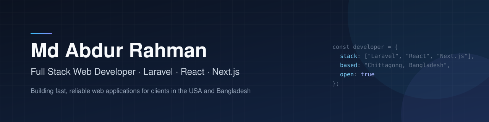

## About

I'm a full stack web developer with 3+ years of experience building production web applications with **Laravel, PHP, React and Next.js**. I've delivered live projects for clients in the **USA and Bangladesh**, including e-commerce stores, restaurant ordering systems, inventory management and nonprofit fundraising platforms.

Since August 2023 I've also been a **web development faculty member at Creative IT Institute, Chittagong**, where I teach HTML, CSS, JavaScript, React, PHP and Laravel, review student code and mentor students through full project cycles.

- 💼 Open to full-time roles and freelance projects
- 🎓 B.Sc. in Electronic and Telecommunication Engineering, IIUC

## Featured Work

| Project | What it is | Stack |
|---|---|---|
| **[Sree Sree Gita Sangha](https://gitasangha.org)** | Website for a New Jersey nonprofit, with online donations and event ticketing supporting a $1M fundraising campaign | Laravel · PHP · MySQL · JavaScript |
| **[Degchi Dine](https://degchidine.com)** · [code](https://github.com/abdurDaily/degchi_dine_restaurant) | Live restaurant platform with online ordering, real-time order tracking, reservations, membership cards and an admin dashboard, with PHPUnit feature tests | Laravel · MySQL · Tailwind CSS · Vite |
| **[E-commerce v2](https://github.com/abdurDaily/e-commerce-v-2.0)** | Online store with product catalog, cart, checkout, order history and an admin panel | Laravel · PHP · MySQL · Bootstrap |
| **[Ecobazar](https://github.com/abdurDaily/ecobazzer_react)** | Storefront built as a component-based React app | React · Vite · JavaScript |
| **[Nexus Admin Dashboard](https://github.com/abdurDaily/nexus_admin_dashboard)** | Multi-page admin UI: e-commerce management, invoices, user management, calendar, chat, kanban and auth pages | HTML · CSS · JavaScript |

## Tech Stack

**Frontend**&nbsp;

**Backend**&nbsp;

**Tools**&nbsp;

## What I Focus On

- **Clean, maintainable code:** MVC architecture, Eloquent ORM, reusable components
- **Complete features:** authentication, role-based access, payments and third-party APIs
- **Fast, responsive UIs:** mobile-first layouts and optimized images and page speed
- **Clear communication:** working directly with clients, from requirements to deployment and support

---

Based in Chittagong, Bangladesh · Open to remote work · <a href="mailto:abdurdiary@gmail.com">abdurdiary@gmail.com</a>

